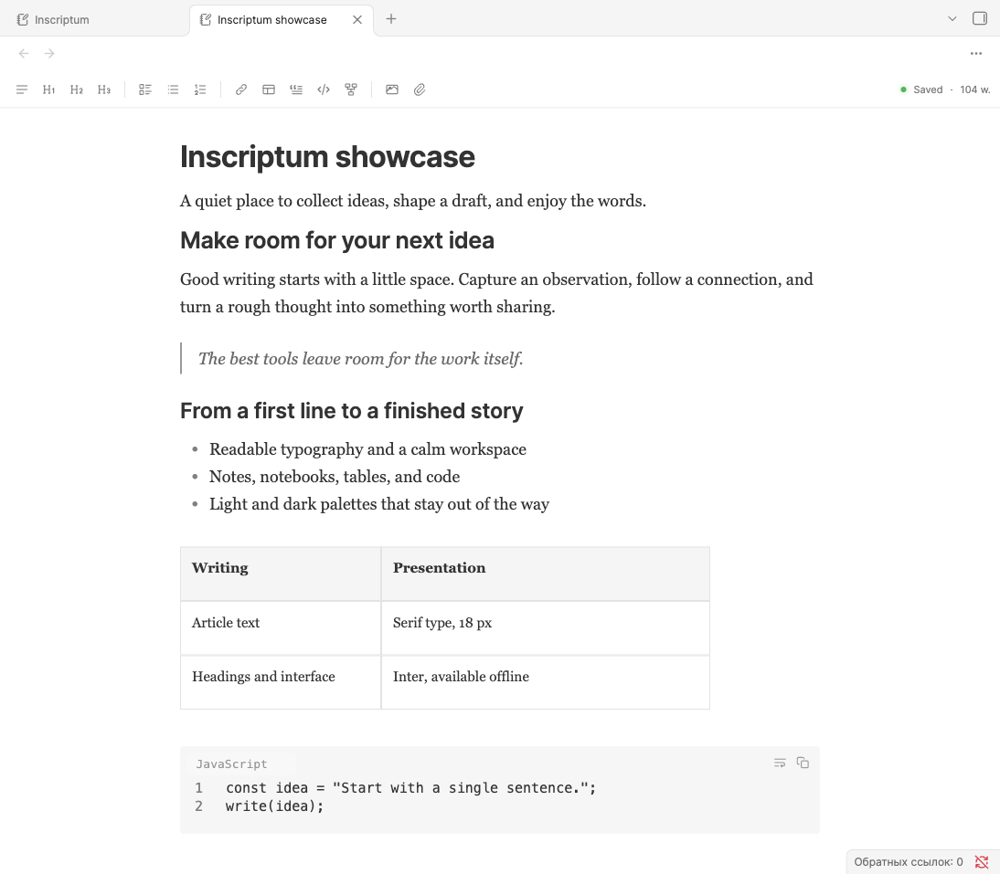
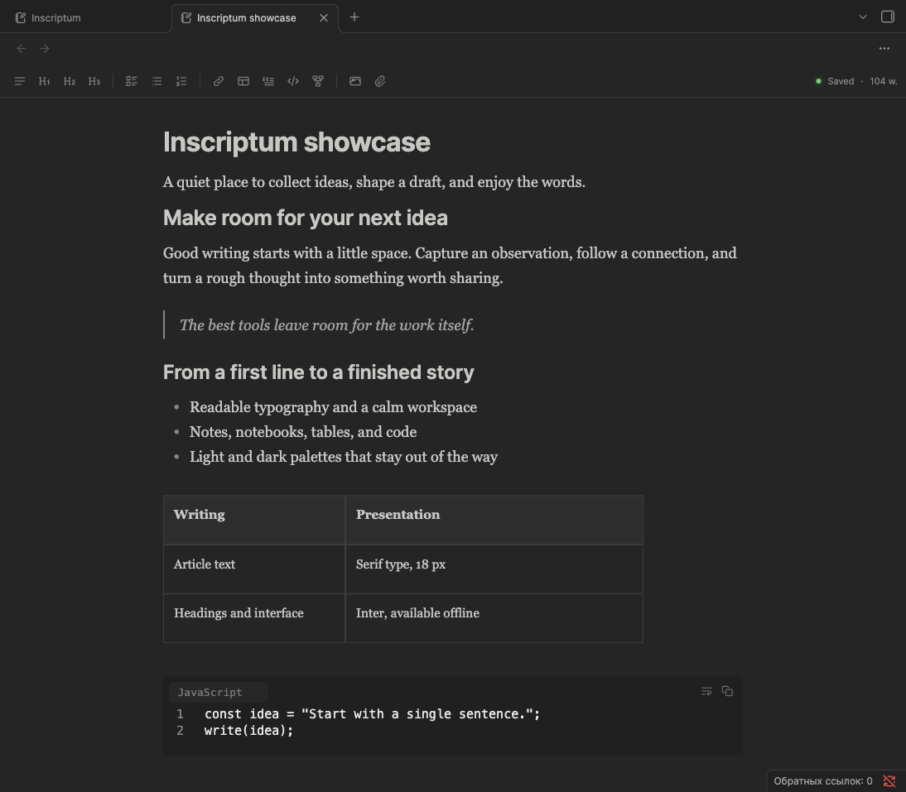

# Inscriptum

A calm, typography-focused Obsidian theme with a paper-like reading surface, neutral gray surfaces and serif body text. It works with or without Inscriptum.

## Features

- Light and dark palettes, with restrained panels, tabs, menus and navigation.
- Georgia / system serif body text, bundled offline Inter for interface and headings, and a readable 18 px text default.
- Standard Markdown Reading view and Live Preview use Obsidian theme variables. Inscriptum `.note` and `.um` documents receive matching typography through a small compatibility layer.
- Existing editor behavior, document content, image layouts and toolbars stay owned by the plugin. The theme also works without the Inscriptum plugin.
- Font preferences in Obsidian continue to take precedence. On devices without Georgia, the installed serif fallback differs; this release does not bundle a serif font.

## Install locally

1. Copy `manifest.json` and `theme.css` into `<vault>/.obsidian/themes/Inscriptum/`.
2. Open **Settings → Appearance → Themes**, then select **Inscriptum**. If it is not listed, reload Obsidian.
3. Select a Light, Dark, or system-adaptive base color scheme in Obsidian.

The theme has not been submitted to the community directory yet. After acceptance, it will be installable from **Settings → Appearance → Manage**.

## License

MIT for project additions. Blog-derived styling retains Apache-2.0 notices, Inter uses SIL OFL 1.1, and the official sample uses 0BSD. See [THIRD-PARTY-NOTICES.md](THIRD-PARTY-NOTICES.md) and `licenses/`.
